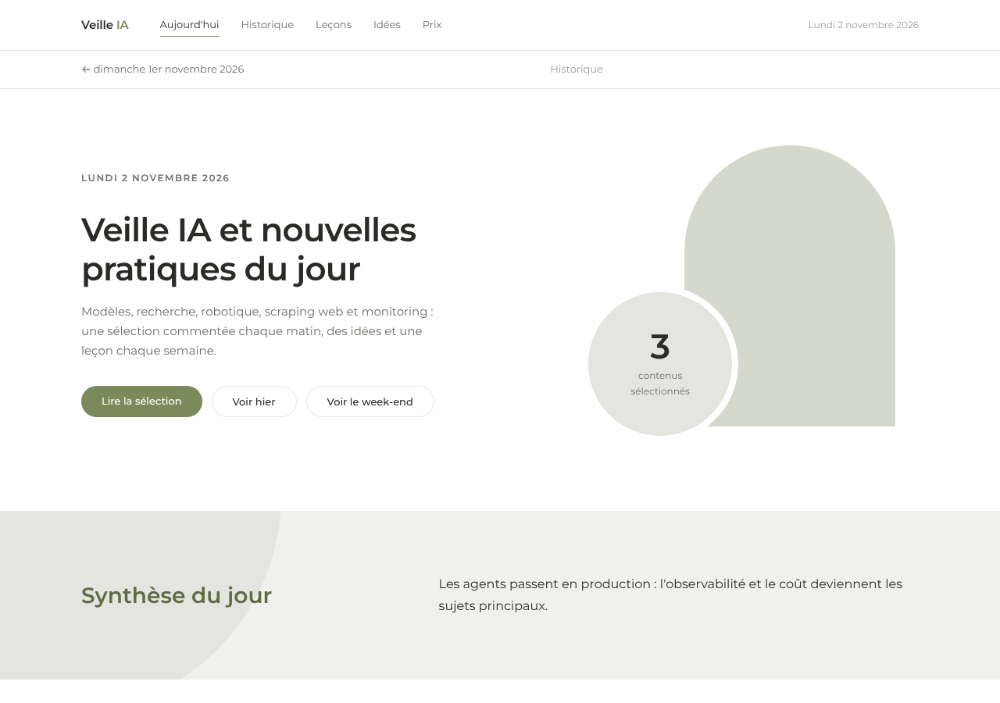
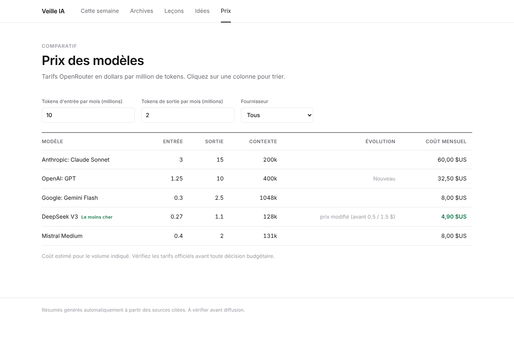

# MAJIA — Ma veille IA quotidienne

Chaque matin, ce projet :

1. **collecte** les nouveautés de ~30 sources réparties en 7 thèmes (voir ci-dessous) ;
2. **trie et résume** les plus utiles pour ton profil avec Gemini (offre gratuite), avec pour chaque élément
   ses **spécificités concrètes** (chiffres, forces, limites), sans blabla marketing ;
3. construit un **tableau comparatif prix / qualité** des modèles à partir de données réelles,
   et signale les nouveaux modèles et les changements de prix ;
4. chaque semaine, génère **3 idées à proposer à ton équipe** et **une leçon complète** (concept, application, exercice, auto-évaluation) ;
5. t'envoie le tout **par e-mail**, l'archive dans le dépôt et le publie sur **ton site web**.

## Le site web

En plus de l'e-mail, ta veille est publiée sur un site (GitHub Pages, gratuit, mis à jour tout seul chaque matin) :

| Page | Ce qu'on y fait |
|---|---|
| **Aujourd'hui** | Les contenus du jour, avec les boutons **Voir hier** et **Voir le week-end**, filtrables par thème (Claude/NVIDIA, robotique, scraping…), la synthèse, le comparatif, les idées et la leçon |
| **Historique** | Chaque jour de veille classé par mois, une page par week-end, et une recherche instantanée dans tous les contenus |
| **Leçons** | Ta base de cours |
| **Idées** | Ton backlog d'idées, à cocher quand elles sont présentées |
| **Prix** | Tableau triable des prix des modèles, filtre par fournisseur et **simulateur de coût mensuel** selon ton volume de tokens |




**Activer le site (une seule fois)** : *Settings → Pages → Build and deployment → Source : **GitHub Actions***.
L'adresse s'affiche ensuite sur cette page (du type `https://<ton-compte>.github.io/MAJIA/`).

> ⚠️ Sur un compte GitHub gratuit, GitHub Pages ne fonctionne qu'avec un **dépôt public** : ton site sera alors visible
> par tous (il ne contient que ta veille, aucun secret). Pour un site privé, il faut un compte GitHub Pro.

Aperçu en local :

```bash
python -m veille.site && python -m http.server -d _site 8000   # puis ouvre http://localhost:8000
```

## Ce que tu reçois

| Section | Sources |
|---|---|
| Modèles et labos | Anthropic/Claude (actus, releases Claude Code et SDK), NVIDIA (blog + blog technique), OpenAI, Google DeepMind, Google AI, Hugging Face, Mistral/DeepSeek/Qwen/Llama |
| Recherche | Hugging Face Daily Papers, arXiv cs.AI / cs.CL / cs.LG (filtrés par mots-clés) |
| Robotique | IEEE Spectrum Robotics, The Robot Report, arXiv cs.RO, actus robots humanoïdes |
| Parsing HTML et scraping | Actus (scraping avec LLM, Firecrawl, Crawl4AI…), releases Firecrawl et Crawl4AI, Hacker News, arXiv cs.IR / cs.CL (extraction web) |
| Monitoring et observabilité | Actus observabilité LLM / AIOps, releases Langfuse, Hacker News |
| Pratiques | Raschka, Latent Space, Import AI, Simon Willison, LangChain, Hacker News |
| Benchmarks et comparatifs | Actus benchmarks, LMArena, Artificial Analysis |
| Comparatif prix / qualité | Tableau chiffré : prix réels [OpenRouter](https://openrouter.ai/models) (entrée/sortie en $ par million de tokens, contexte) pour Claude, GPT, Gemini, Mistral, Llama, DeepSeek, Qwen, Grok, NVIDIA ; score de qualité et vitesse [Artificial Analysis](https://artificialanalysis.ai) si tu ajoutes la clé (optionnel) ; analyse du meilleur rapport qualité/prix par usage |

| Dossier / fichier | Rôle |
|---|---|
| `sources.yaml` | Ton profil, tes mots-clés et la liste des sources (à personnaliser) |
| `digests/` | Les veilles quotidiennes archivées (Markdown) |
| `lecons/` | Ta base de cours, une leçon par semaine |
| `idees.md` | Ton backlog d'idées, à cocher quand tu les présentes |
| `data/vus.json` | Les liens déjà traités (évite les doublons) |
| `data/prix.json` | Les prix de la veille précédente (pour détecter les changements) |
| `data/semaines/` | Chaque veille du jour en JSON, utilisée pour construire le site |
| `veille/site.py` | Le générateur du site web |

## Mise en route (≈ 15 min)

1. **Clé Gemini** : crée une clé gratuite sur <https://aistudio.google.com/apikey>.
2. **Mot de passe d'application Gmail** : active la validation en deux étapes sur ton compte Google, puis crée un mot de passe sur <https://myaccount.google.com/apppasswords>.
3. **Secrets GitHub** : dans *Settings → Secrets and variables → Actions*, ajoute :

   | Secret | Valeur |
   |---|---|
   | `GEMINI_API_KEY` | ta clé Gemini |
   | `SMTP_USER` | ton adresse Gmail |
   | `SMTP_PASSWORD` | le mot de passe d'application (16 caractères) |
   | `EMAIL_TO` | l'adresse qui reçoit la veille (plusieurs : séparées par des virgules) |
   | `ARTIFICIAL_ANALYSIS_API_KEY` | *(optionnel)* clé gratuite sur <https://artificialanalysis.ai> pour ajouter les scores de qualité et de vitesse au comparatif |

4. **Premier envoi** : onglet *Actions* → *Veille IA quotidienne* → *Run workflow*.

Ensuite, la veille tourne automatiquement chaque matin vers 7 h (heure de Paris) :

- **Du lundi au vendredi** : un e-mail avec la sélection du jour.
- **Samedi et dimanche** : pas d'e-mail, mais le site est mis à jour. Le **lundi**, l'e-mail contient en plus
  une section « Ce que tu as raté ce week-end » (réglage `mail_weekend` dans `sources.yaml`, `normal` pour
  recevoir un e-mail chaque jour).
- **Leçon et 3 idées** : une fois par semaine, le lundi (réglage `lecon_le` : un autre jour, ou `tous`).

## Personnaliser

- **Ton profil** (`profil` dans `sources.yaml`) : plus il est précis, plus les idées et leçons sont pertinentes.
- **Mots-clés** (`mots_cles`) : filtrent les flux très volumineux (arXiv, Hacker News). Une source peut avoir ses propres `mots_cles`.
- **Sources** : ajoute un bloc `nom` / `url` (flux RSS ou Atom) / `categorie`
  (`modele`, `article`, `robotique`, `parsing`, `monitoring`, `pratique` ou `comparatif`).
  Astuce : n'importe quelle recherche Google News devient un flux avec
  `https://news.google.com/rss/search?q=TA+RECHERCHE+when:7d&hl=en-US&gl=US&ceid=US:en`,
  et les releases d'un projet GitHub avec `https://github.com/OWNER/REPO/releases.atom`.
- **Comparatif** (`prix` dans `sources.yaml`) : fournisseurs suivis et nombre de modèles récents par fournisseur.
- **Volume** : `max_par_source` (plafond par source) et `max_selection` (nombre d'éléments dans l'e-mail).
- **Modèle** : variable d'environnement `GEMINI_MODEL` (par défaut `gemini-2.5-flash`).
- **Autre serveur mail** : variables `SMTP_HOST` et `SMTP_PORT` (SSL, 465 par défaut).

## En local

```bash
python -m venv .venv && source .venv/bin/activate
pip install -r requirements.txt
pytest -q                                              # test complet avec un LLM simulé
GEMINI_API_KEY=xxx python -m veille.main --dry-run     # affiche la veille sans envoyer d'e-mail
```

## Limites à connaître

- Les résumés se basent sur les **abstracts et extraits RSS**, pas sur les PDF complets : vérifie l'article avant de le citer en réunion.
- Le LLM ne peut citer que des liens réellement collectés (les liens inventés sont rejetés), mais un résumé peut rester imprécis.
- Anthropic et Mistral n'ont pas de flux RSS officiel : ils sont suivis via Google News et les releases GitHub, donc certaines annonces peuvent arriver avec du retard ou via des articles de presse.
- Les prix OpenRouter sont ceux de la plateforme (en général identiques aux tarifs officiels, mais vérifie avant une décision budgétaire). La « qualité » n'est chiffrée que si tu ajoutes la clé Artificial Analysis ; sans elle, le comparatif se base sur les prix et les benchmarks cités dans l'actualité.
- Si une source est en panne ou change d'URL, elle est ignorée (visible dans les logs de l'Action) et la veille part quand même.

## Ta routine (le vrai levier)

- **Chaque matin, 10 min** : parcours la veille du jour (et le week-end le lundi).
- **Lundi, 30 min** : fais la leçon de la semaine et son exercice.
- **Dans la semaine** : présente **une** idée de `idees.md` à ton équipe, puis coche-la.
